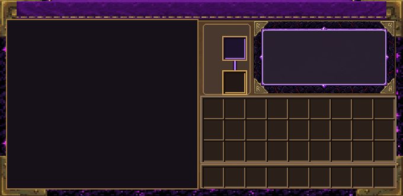

# 现有玩法与全页面适配审查（研究已撤回）

日期：2026-10-28。当前工作分支：arena/65a61f8b-chiseled-enchanting-table-26-1。

## 0. 状态与证据边界

用户确认撤回研究全部改动。5a3cced用普通撤回提交恢复PR23合并基线b3cb3c9：
研究核心、命令原型、试验目录、研究测试及活动规划均撤回；历史仍在Git，不强推。
该提交的索引树与b3cb3c9一致。彩虹、典籍目录、既有加工及配置功能保留。

本报告是源码驱动的实际操作分析，不是“我已经长期生存游玩”的声明。
已检查主界面、配置界面、典籍界面及叠加初始化、主要报价/等待/锁定路径、扫描及验证入口。
仓库约200个Java文件，不能把这一轮定向审查说成逐行完整审计。后续新增判断必须追到实现并验证。

## 1. 真实环境与能做/不能证明的事

- main是世界数据/规则/支付/菜单/网络；client是绘制/输入/物品模型；clientSmoke是独立测试mod，不进发布jar。
- 当前本地没有java可执行文件。不能在这里假装启动MC或本地Gradle通过。
- 能本地跑Python静态/结构/语言/同步/发布检查；这些不证明文字真实可见或鼠标命中正确。
- 能使用现有GitHub Actions运行Java25编译与JUnit、完整构建、关闭JEI/REI编译、实际服务端世界与SDL客户端。
- server_smoke验证实际队列保存/完成/非法注册项隔离等；clientSmoke有真实中文输入、菜单操作、资源重载与截图。
- 当前clientSmoke主要是固定窗口的一条脚本路径，不是完整分辨率、GUI缩放、长语言与动态resize矩阵。
- 构建artifact提供可安装jar，保留14天；Checks诊断可按源码SHA追溯。不能拿旧SHA的成功证明新改动。
- 沙箱出网有白名单，不可任意访问Mojang/Maven站点；源码/API参考可经GitHub核对，依赖构建由CI执行。
- 原生自动化证明所覆盖交互的正确性，不证明玩法有趣、所有资源包兼容或真人主观体验。

## 2. 历史回归风险（已核对提交，不只读注释）

- 3bd875c：图标与面板原点曾不一致；适配必须共用几何，不能只移动背景。
- 2d275c8：共享内框、带框图标；不能修缩放时换回无框字符按钮。
- b20e151：中文标签、安全区、真实SDL截图；新验证必须继续覆盖。
- 927e665：恢复🔒、缩减tooltip墙、统一tab；不能再用字体兼容理由替换🔒。
- 典籍/配置是可叠加页面；每个输入入口都需要明确归属，不能只看主界面截图。

## 3. 从真实需求出发评价当前玩法

### 3.1 起步：为什么不用原版/村民/铁砧？

价值是可选择的加工、书房收藏与稳定预览，不是新资源名称本身。评估应比较：
拿到第一本书后距离第一件有用装备还有几步，每步是否改变决定，还是只转移物品。
若精确加工多收经验、材料、母版磨损，又等书架门槛，初期可能反而不如合并两本书。
这不能仅靠“最终更便宜”解释；需要分别测首件工具、整套装备、成熟交易所三种路径。

### 3.2 建设：更好的书房不一定更好用

InscriptionRitualMechanics.shouldRequireRitualWait明确由书架门槛或典籍词条总量触发等待；
computeSingleEnchantWaitTicks中书架/典籍负载又正向影响时长。
因此增加收藏可能让同一次普通加工增加等待，这不是单纯文案问题。
玩家可能另建低配台处理普通工作；它不必是漏洞，也可能使原限制只剩换台负担。
高级能力仍可能需要足够书架，不能未经验证声称全部等待都能无损绕过。
待决：等待是仪式表现、产能安排还是经济约束？三种职责不能同时含糊承担。

### 3.3 批量制作：费用、磨损、等待、风险可能在重复收费

评价一套装备总流程，而不是孤立按钮：选词条、找材料、付经验、付母版寿命、等队列、
处理恢复/提前取书。若多项成本都只是限制同一产量，应决定主成本，避免层层加码。
多台并行/备用典籍是否划算需测实际成本；正常扩建设施不应被先称防刷漏洞。

### 3.4 母版：收藏成果还是生产耗材？

默认wear、有限次数、复制磨损、恢复计时让收藏兼有生产库存属性。
低频玩家可能平时无感、集中做整套时被卡；高频玩家则轮换多份。这两种体验不一样。
要明确是否真希望玩家经营库存，不能一边奖励收藏，一边不提供管理工具又处罚使用。
本轮不重新引入研究，也不因研究已撤回而默认旧维护机制合理。

### 3.5 锁定：正规费用与拆装替代

TomeLockGuards默认允许拆锁定书架并清除锁定；直接取书却可被拒绝。
所以提前解锁费至少可能成为免拆装便利费，而非强经济限制。
不直接以“禁拆”堵洞。先区分防误取、未完成投入、收益承诺，再问哪个值得保留。
拆架是否失去恢复进度需另外验证，不声称完全无损。

### 3.6 复制与世代：策略还是知识税

若保存低世代母本、只从它复制长期占优，衰减可能主要惩罚不熟悉的玩家。
需比较恢复母本、复制、外部获取的实际支出；没有证据前不宣称世代必然有效限制产量。

### 3.7 去附魔：低频并非失败

精准附魔减少了错误，自然减少清空重抽需求。定向去除、诅咒处理、珍贵装备整理仍可有价值。
要比较定向剔除费用与直接重做物品；不强行加每日回收奖励，让它变成必做准备手续。
来源追踪和守恒能防内部套利，不代表所有拆解定价值得用。

### 3.8 数字：支付简单与价值扁平不能混为一谈

DataCostTables.XpCostRule对无覆盖项按相对等级从levelOneCost插值至commonMaxCost；
不同最大等级的普通附魔在最高级可能落在同一基础价格，而特殊覆盖项不同。
应看最终报价（折扣、材料、升级抵扣、来源返还），不能只看基础JSON判断全体同价。
若未来改上限，按新max归一化会影响旧级相对价格；目前不再推进超限，仍记录为设计风险。
经验等级与经验点也不能混用；农场玩家与探索玩家的机会成本不同。

### 3.9 后期动力：允许设施建成，而不是永远欠维护

装备需求有限，修补等机制延长使用寿命。附魔书房可以是一段有结束感的建设目标，
不是必须强做无限日常。多人服务、收藏、扩展装备是正向内容；损耗循环未必等于长线内容。

### 3.10 UI不是装饰，是成本与结果的可理解性

玩家首先需要知道：这件装备能做什么、为什么不能做、要付什么、得到什么。
没有这些，规则越丰富，外部攻略越成为必需。缩放时首先保护操作、报价与结果，
详细机制按需展开，不把较小窗口的解决办法做成缩字到不可读或更多tooltip墙。

## 4. UI源码发现：三个页面不是同一种问题

| 页面 | 已确认实现 | 风险，不冒充已复现全部症状 |
|---|---|---|
| 附魔台主界面/典籍目录tab | 构造固定340×166，列表151×141；init/reposition只重定位 | 逻辑宽320时主面板已比视口宽20；大屏只居中不扩内容 |
| 配置独立页/叠加页 | 先把真实width/height抬到至少320/220再交布局 | 真实可用区域被“伪造放大”；布局内部合格也可能超真实屏幕 |
| 典籍独立页/叠加页 | bookW至少336、bookH至少212，另有偏移 | 逻辑宽320时书本至少336，窄屏必有越界可能；小高度同理 |
| 所有叠加输入 | 主屏转发坐标，子屏按自身几何命中 | 不能只缩背景不改文字/裁剪/槽位/输入；当前尚未做resize矩阵 |

例：960×640若实际GUI比例为3，则逻辑约320×213。上述最小尺寸便与真实空间冲突。
这只是几何推演；实际MC自动GUI比例可能选择不同值，需记录真实逻辑尺寸，不能按物理分辨率猜。

## 5. 下一步测试矩阵与验收

物理窗口：960×640、1280×720、1920×1080、超宽；GUI比例：自动、可用的2/3/4。
每项记录真实逻辑宽高，不强制宣称不被MC接受的组合可测。

场景：主加工/升级/去除/典籍tab，配置独立/叠加，典籍独立/叠加；打开时改变窗口、调整GUI比例、
返回外部查看器，检查位置、滚动、选择、焦点、剪裁、tooltip、背包槽、右下操作和关闭按钮。
长中文/德文与🔒、金色安全角、各tab、带框图标都在验收范围。

验收不是“截图文件存在”：可操作区域必须在视口中，真实点击命中，UI状态不因resize丢失，
背景/控件/文字/裁剪使用同一布局来源。窄屏不能靠隐藏必要操作通过，大屏不默认拉大字体。

## 6. 人审边界与当前顺序

1. 本报告先分析现有玩法；不把已撤回研究作为解决方案偷偷复活。
2. 先确定自适应的可见行为，再由开发者选择几何/输入实现，不要求玩家定架构。
3. 默认复用现有背景、tab、按钮框；需要新图才请求AI多方案。跳过表示全不满意，重做，不代选。
4. 没有用户确认，不改费用、等待、磨损或专精规则；把方向性问题逐批讨论。
5. 本报告不等于完整仓库审计已结束。后续每项代码改动与新证据均更新范围和状态。

## 7. 第一批实际修复与证据（26c0d43）

本节更新前面的初始审查状态，不代表全页面已修复。

- 配置页与配置叠加页不再把真实视口放大到至少320×220。
- 面板尺寸回退不再强行保留268×198，从而允许320×180、320×213这样的实际逻辑视口。
- 正文区域按剩余空间计算高度，不为了保留60像素正文而侵入底部操作区；原有滚动逻辑负责显示剩余内容。
- 新增“面板在实际视口内”“安全内框在面板内”的不变量，避免只检查内部自洽。
- 3项新JUnit测试覆盖320×180/200/213/240、427×240、480×270、854×480与1920×1080的尺寸、边界与适度增长。
- 实际配置Screen初始化/重新初始化探针加入原生客户端smoke；它验证Screen没有伪造宽高，**不是物理SDL窗口resize或全页面视觉矩阵**。
- [compile-check 40585863020](https://github.com/q14433686-arch/chiseled-enchanting-table-26.1.2-source/actions/runs/40585863020)：Checks诊断确认Java构建成功，158项JUnit，0失败/错误，包含3项ConfigViewportTest。
- [build 40585862986](https://github.com/q14433686-arch/chiseled-enchanting-table-26.1.2-source/actions/runs/40585862986)：已成功；完整构建、无JEI/REI编译、真实服务端与SDL客户端任务全部成功。Checks诊断明确包含`CONFIG VIEWPORT PASS`与`CLIENT SMOKE PASS`。配置Screen重新初始化探针已实际运行通过，但没有物理窗口resize或全页面截图通过的含义。
- 撤回研究的5a3cced：compile-check 40585191691、build 40585192731均已成功。

### 仍未完成

主加工/升级/去除/典籍目录tab、典籍独立/叠加页仍未实施自适应；配置页的物理窗口resize、
长中文/德文和鼠标实际命中矩阵也未完成。320宽以下或更极端的小高度不在本批测试保证范围。

继续核对原版26.3源码发现：Slot.x/y为final，AbstractContainerScreen的槽位绘制、
高亮和命中直接使用这些坐标。主屏不能只改变背包图片或单独挪动renderSlot；
必须同步解决槽位、背景、命中与拖放的坐标来源。该结论来自原版源码，不是注释推断。

## 8. 沿用的现有图像素材

以下是仓库现有素材，**不是新设计、更不是游戏运行截图**。本批没有替换它们，
也没有将素材图当作界面适配通过的证据；后续布局审查图与原生截图另行标注。

主界面原有底图：

典籍原有双页素材：

